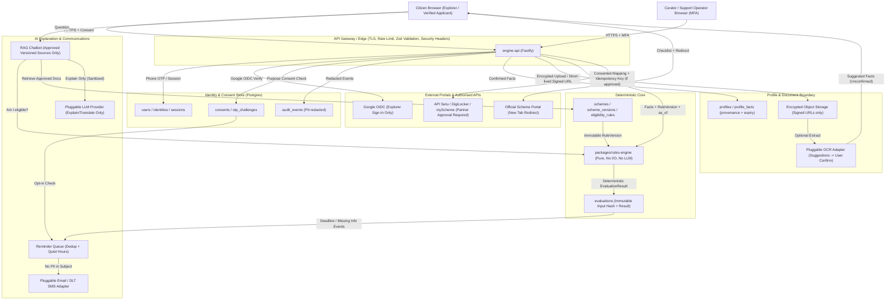

# Data Flow Diagram — Sahayak (PS 26)

## End-to-End Trust Boundaries & Data Flows

## Key Invariants
1. **`packages/rules-engine` is air-gapped from I/O, network, clocks, and LLMs.**
2. **Identity, profile facts, documents, and audit logs live in separated logical stores/schemas.**
3. **No raw Aadhaar numbers, OTPs, tokens, or bank account numbers are logged or included in email subjects.**
4. **Documents have no public URLs — access requires server-side authorisation and short-lived signed URLs.**
